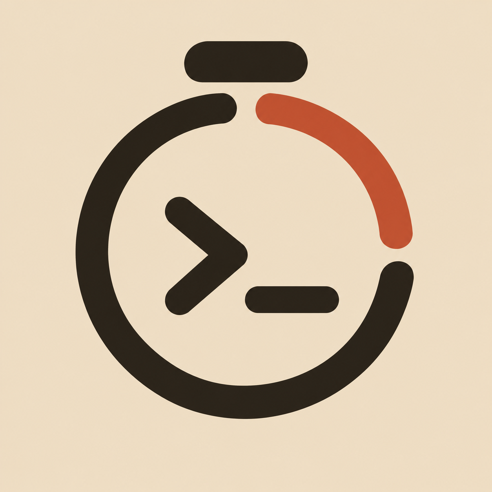
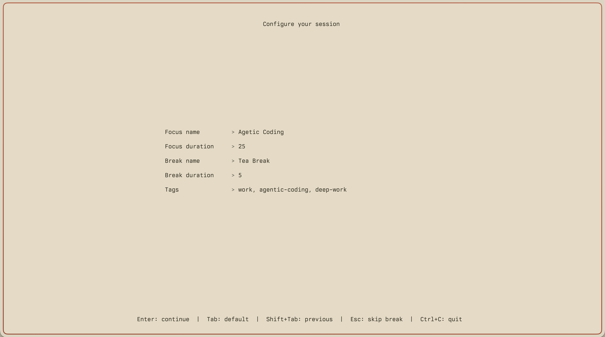
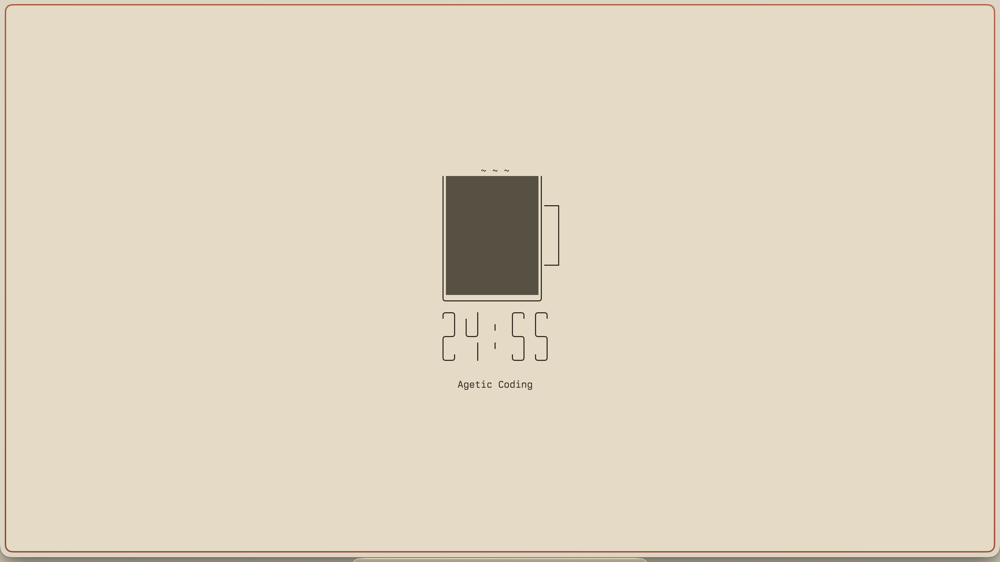
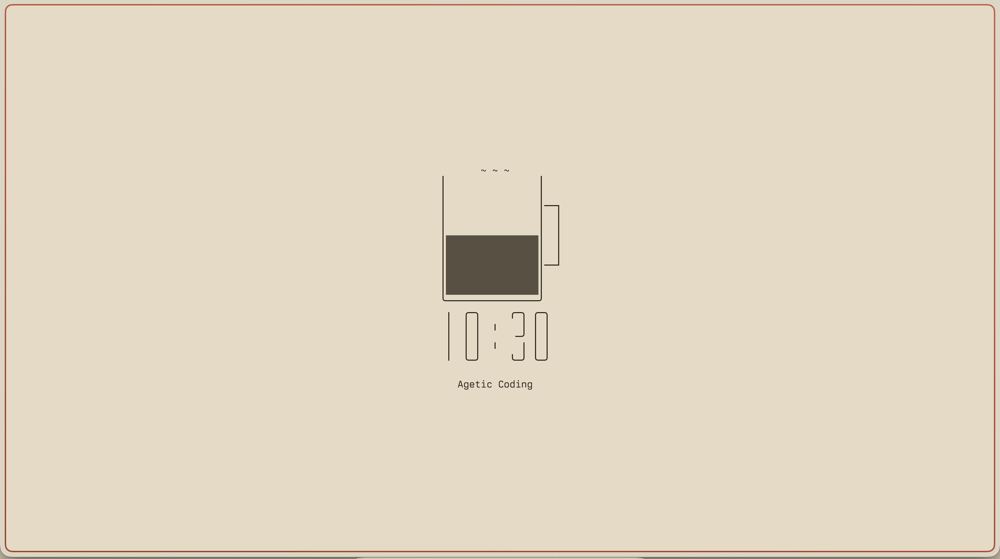
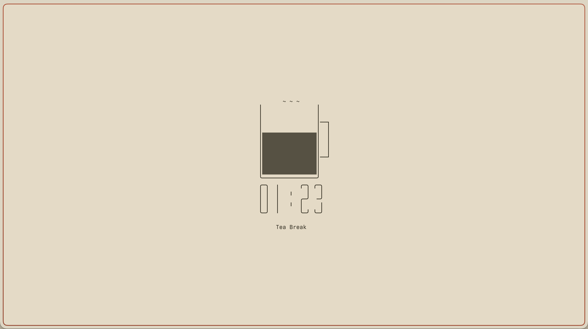

# flowterm

<p align="center">
  
</p>

A terminal focus timer. Run focus and break sessions, see which apps you used
while working, and review your history without leaving the terminal.



## Requirements

- Go 1.27 or newer to build from source.
- macOS or Linux. App and idle tracking use the macOS CoreGraphics API. On
  Linux the timer and stats work, but tracking is unavailable.

## Install

```sh
go install github.com/hpdipto/flowterm@latest
```

Make sure `$(go env GOPATH)/bin` is on your `PATH`.

Build from source:

```sh
git clone https://github.com/hpdipto/flowterm.git
cd flowterm
go build -o flowterm .
```

## Usage

Run `flowterm` with no arguments. The form asks for a focus name, focus
duration in minutes, a break name, break duration in minutes, and optional
comma-separated tags.

The session starts immediately after the form. The cup drains while the timer
runs.







| Key | Action |
| --- | --- |
| `Tab` | Next field, or accept the default name |
| `Shift+Tab` | Previous field |
| `Enter` | Continue |
| `Esc` | Skip the break |
| `Ctrl+C` or `q` | End the session and quit |

Ending a session early marks it interrupted.

### Stats

```sh
flowterm stats                  # last 1 day
flowterm stats --since 7        # last 7 days
flowterm stats --all            # include interrupted sessions
flowterm stats --tag coding     # only sessions with this tag
flowterm stats --summary        # print totals above the table
flowterm stats --apps           # per-app focus and break totals
```

### Delete data

```sh
flowterm delete --all
```

Deletes every session with its activities and tag links, then vacuum the
database.

## Data location

The database lives at `~/.config/flowterm/flowterm.db`. Set `DB_NAME` to use
another path:

```sh
DB_NAME=./flowterm.db flowterm
```

Only one instance runs at a time. A lock file next to the database enforces
this. The operating system releases it when the process exits.

## Development

```sh
go test ./...
```

Migrations are embedded and run on startup. To work with them directly, use
the Makefile:

```sh
make migration-up
make migration-status
```

`DB_NAME` overrides the database path for these targets too.

## License

MIT
